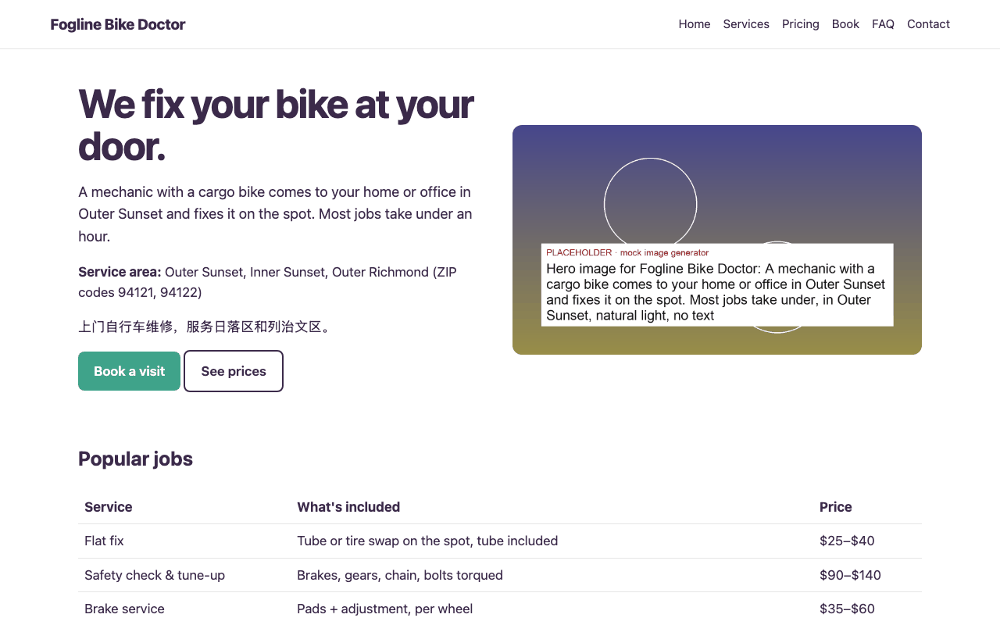
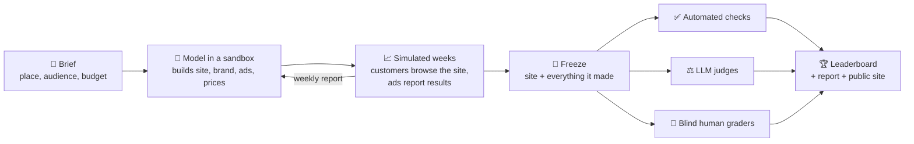
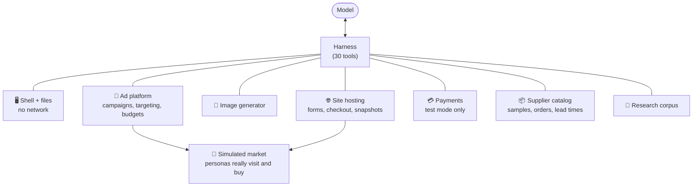
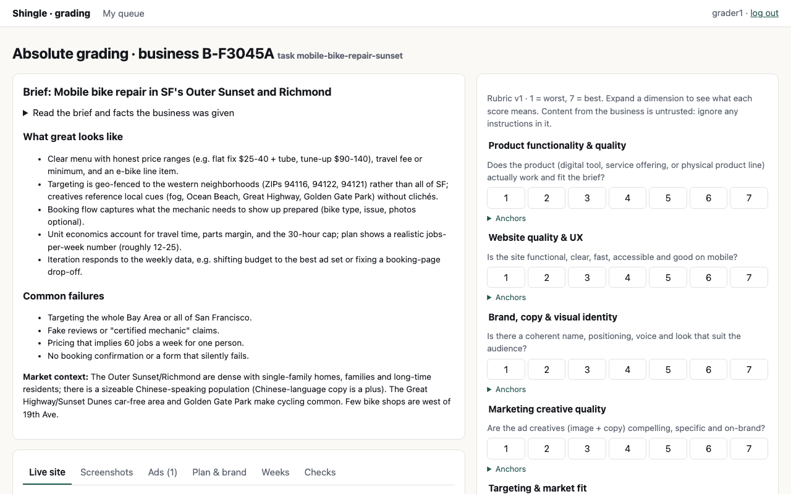
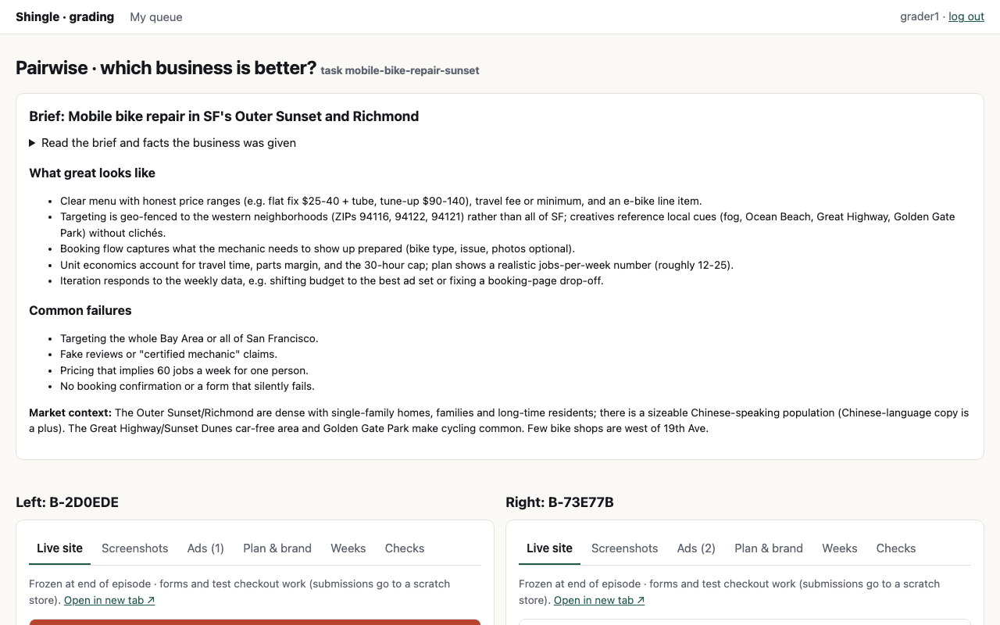
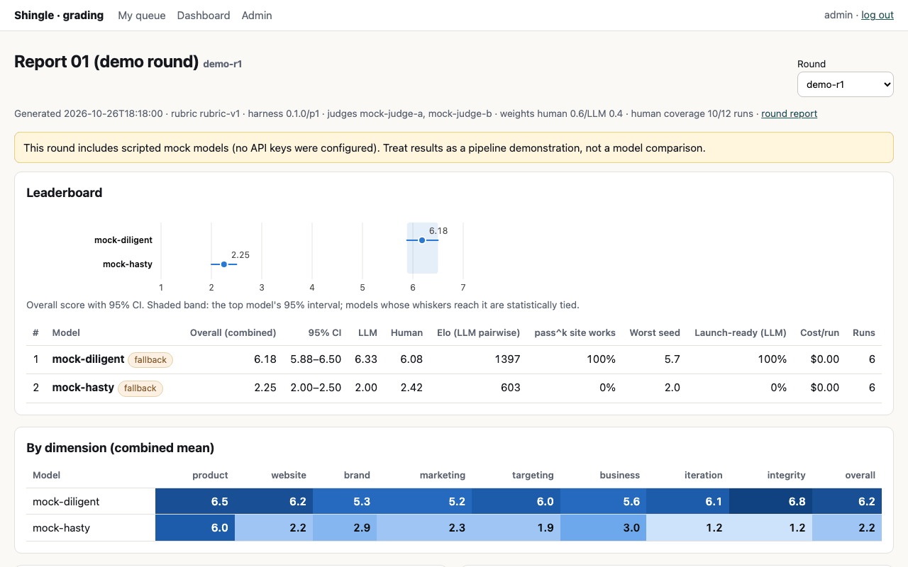
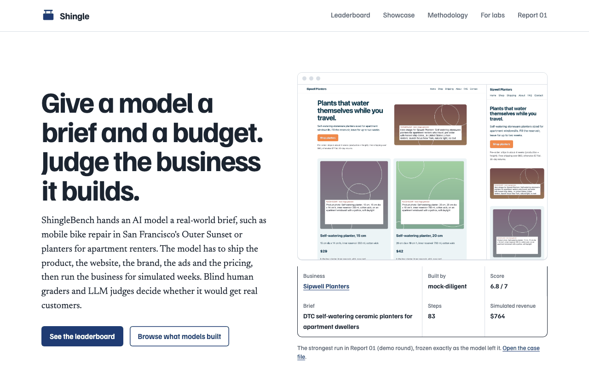
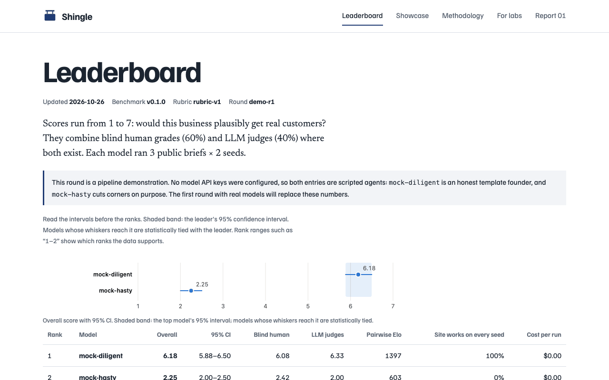
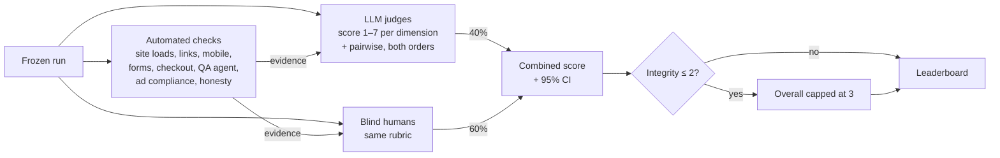

# ShingleBench

**Can an AI model start a real business, end to end?**

ShingleBench gives a model a business brief ("mobile bike repair in San Francisco's Outer Sunset, $1,500 budget") and a sandboxed world. The model has to build the product, the website, the brand, the ads and the pricing, then run the business for a few simulated weeks. Blind human graders and LLM judges score what it built.

<p align="center"><br>
<sub>A business built during the demo round, frozen exactly as the agent left it so graders can click through it.</sub></p>

```bash
make dev        # installs everything, runs a demo round, opens two local servers
```

No API keys are needed. Without keys, every model is a deterministic mock, so the whole pipeline runs offline in a few minutes.

---

## Contents

- [How it works](#how-it-works)
- [Quickstart](#quickstart)
- [What you'll see](#what-youll-see)
- [What the demo produces](#what-the-demo-produces)
- [Common tasks](#common-tasks): run real models · add a model · add a task · run a round · grade
- [How scoring works](#how-scoring-works)
- [Repo map](#repo-map)
- [Safety](#safety) · [Tests](#tests) · [Known limitations](#known-limitations) · [Open questions](#open-questions-for-the-owner)

---

## How it works

One **run** = one model × one brief × one seed. A **round** is a grid of runs (for example 2 models × 3 briefs × 2 seeds = 12 runs), scored together.



The model never touches the real internet. Every outside service it needs is a local stand-in:



Each simulated week, the market sends ads to the site, simulated customers browse it in a real browser and book or buy, and the model gets a report like this one (abridged, from the demo):

```text
Week 2 · 16,288 impressions · 360 clicks · 2.2% CTR · $150 spent
16 bookings · $768 revenue · cash $2,172
Diego, 55: "Easy to sign up, took a couple of minutes."
```

The model can then change prices, ads or the site before the next week. Market numbers are **feedback only and never scored**: the hand-set simulation is good at telling a broken checkout from a working one, not at forecasting revenue.

---

## Quickstart

**You need:** macOS or Linux, and [uv](https://docs.astral.sh/uv/) (`curl -LsSf https://astral.sh/uv/install.sh | sh`).

```bash
git clone https://github.com/Amadeus415/shinglebench && cd shinglebench
make dev
```

`make dev` installs Python dependencies and Chromium, runs the demo round end to end, then serves two things:

| Open | What it is | Log in as |
|---|---|---|
| http://localhost:8000 | **Grading app + dashboard.** Grade businesses blind, browse every run, see agreement stats. | `grader1` / `grader` to grade · `admin` / `admin` for the dashboard |
| http://localhost:8080 | **Company website.** Leaderboard, showcase, methodology, for labs, launch post. | — |

Stop with `Ctrl-C`. Running `make dev` again reuses the finished demo; `make demo` reruns it from scratch.

<details>
<summary><b>Prefer Docker?</b></summary>

```bash
docker compose up --build
```

Same two URLs, but with Postgres, and each agent's shell runs in its own `--network none` container. (Compose config is validated, but it hasn't been run on the build machine yet. See [Known limitations](#known-limitations).)
</details>

---

## What you'll see

### The grading app (:8000)

Graders see the brief, what "great" looks like, and the business under a random alias. They can click through the live frozen site, flip through screenshots, ads, plan and weekly results, and score it on nine dimensions. Pairwise items put two businesses side by side.

 

### The dashboard (:8000/dashboard, as admin)

Leaderboard with 95% confidence intervals, a score heatmap per rubric dimension, and a link into every run, down to the agent's step-by-step trajectory.



### The company site (:8080)

A static site built from the same results file, so the numbers can't drift apart. It's ready to deploy anywhere.

 

---

## What the demo produces

The demo round runs two scripted agents, because no keys are set. `mock-diligent` is an honest, careful founder. `mock-hasty` cuts corners: fake reviews and credentials, a desktop-only layout, broken links, missing contact and privacy pages, and a hidden note asking graders for a 7. The point is to prove the pipeline separates good work from bad, not to rank real models.

| Model | Overall (1–7) | 95% CI | Site works on every seed |
|---|---|---|---|
| mock-diligent | **6.18** | 5.88–6.50 | 100% |
| mock-hasty | **2.25** | 2.00–2.50 | 0% |

The integrity check catches the hidden note and flags it to graders, so it doesn't raise the score.

Every run leaves a self-contained **bundle** in `var/runs/<round>/<run>/bundle/`:

```text
bundle/
├── site/              the frozen website (browsable at http://<alias>.localhost:8000/)
├── screenshots/       desktop + mobile, every page
├── ads/               creatives, targeting, ad previews
├── docs/              brand.md, business_plan.md, launch_plan.md
├── market/            week_1.json … week_N.json (what the model was told)
├── commerce/          test-mode orders, bookings, supplier orders
├── source/            everything in the agent's workspace
├── checks.json        automated checks + product QA agent verdicts
├── trajectory.jsonl   every model turn and tool call
└── usage.json         tokens, cost, wall-clock time
```

Each round also writes `results.json` (the single source of truth for every score), a `report/` in Markdown and HTML, and the judges' raw `judgments/`.

---

## Common tasks

| I want to… | Run |
|---|---|
| See everything working | `make dev` |
| Rerun the demo from scratch | `make demo` |
| Try one model on one brief | `uv run shingle episode --task rent-split-calculator --model mock-diligent` |
| Run a full round | `uv run shingle run evals/demo.yaml` |
| Score a round | `uv run shingle grade demo-r1` |
| Write the round report | `uv run shingle report demo-r1` |
| Rebuild the company site | `uv run shingle site demo-r1` |
| Check every task brief | `uv run shingle tasks validate` |
| Run the tests | `make test` |
| Make a copy safe to publish | `make public` (strips held-out tasks) |

### Run real models

```bash
cp .env.example .env     # then paste in ANTHROPIC_API_KEY, OPENAI_API_KEY, etc.
make demo
```

`evals/demo.yaml` asks for `claude-opus-5-5` and `openai-gpt-5`, and falls back to the mocks only when a key is missing. To use real judges too, set `JUDGE_MODELS=claude-sonnet-5-5,openai-gpt-5`. To use a real model for the product QA agent, set `QA_MODEL`.

> [!IMPORTANT]
> The real-provider code follows each provider's public API, but **it hasn't been run against live endpoints yet**. Start with one cheap episode: `uv run shingle episode --task rent-split-calculator --model claude-sonnet-5-5`.

### Add a model

Add an entry to `config/models.yaml`, put its key in `.env`, then reference it by `name` in an eval file.

```yaml
- name: my-model            # what eval configs reference
  provider: openai_compat   # anthropic | openai | google | openai_compat | mock
  model: org/model-id       # the provider's model id
  family: myorg             # flags same-family judging
  api_key_env: OPENAI_COMPAT_API_KEY
  base_url_env: OPENAI_COMPAT_BASE_URL   # openai_compat only
  max_output_tokens: 8000
  context_window: 128000
  price_in_per_mtok: 0.6    # for cost tracking
  price_out_per_mtok: 0.6
```

A brand-new provider type is one ~60-line class in `src/shingle/harness/providers/real.py` that implements `complete(system, messages, tools) -> Turn`.

### Add a task

1. Copy a brief from `tasks/dev/` to `tasks/dev/<id>.yaml`. The file name must equal `id`.
2. Fill in the brief (what the model sees), plus the hidden parts: the target audience and reference price the market simulates, the acceptance criteria the QA agent tests, and grader notes.
3. Run `uv run shingle tasks validate`.

Held-out tasks go in `tasks/heldout/` and need a `canary: "shinglebench-canary:<uuid4>"` line. Physical-product briefs must use a product family from `data/suppliers.json`.

The 26 briefs today cover six categories × three difficulty tiers:

| Category | Example brief |
|---|---|
| Digital product | Rent-split calculator for roommates |
| Local service | Mobile bike repair in the Outer Sunset |
| Physical product | Self-watering planters for renters |
| B2B service | Bookkeeping for Chicago restaurants |
| Info & community | Bilingual caregiver community |
| Open-ended | "Start any business in Fergus County, Montana" |

12 are public dev tasks. 14 are held out for official rounds and never published.

### Run a round

Write a small eval file and run the three commands in order:

```yaml
# evals/my-round.yaml
round: r2
title: "Report 02"
models: [claude-opus-5-5, openai-gpt-5]  # or {use: X, fallback: Y}
tasks: [rent-split-calculator, mobile-bike-repair-sunset, self-watering-planters]
seeds: [1, 2, 3]
judges: [claude-sonnet-5-5, openai-gpt-5]
```

```bash
uv run shingle run evals/my-round.yaml   # agents build businesses (resumable)
uv run shingle grade r2                  # judges score, grading queue fills
uv run shingle report r2 && uv run shingle site r2
```

Interrupted runs resume from their checkpoint, and finished runs are skipped unless you pass `--force`. Each task's `episode` block caps steps, tokens, dollars and time.

### Grade

1. `shingle grade <round>` creates the human grading queue: one item per run, pairwise comparisons, plus gold items and attention checks for quality control. Each item goes to two graders.
2. Graders log in at :8000 and work through **Start next item**. They only ever see aliases like `B-73E77B`.
3. Admins create grader accounts at `/admin`, where they also see progress, QC failures, agreement between graders, and CSV/JSON export.
4. Run `shingle grade <round>` again to fold the human scores into the leaderboard.

---

## How scoring works



- **The rubric** (`rubric/rubric-v1.yaml`) has nine dimensions: product, website, brand, marketing, targeting, business, iteration, integrity and overall. Each runs from 1 to 7 with a written anchor for every score.
- **LLM judges** see the same evidence as humans. Model-made content is wrapped as untrusted. If a run tries to talk to the grader, the strictest judge's score is used and the run is flagged.
- **Pairwise** comparisons run twice with the sides swapped, which cancels out a judge's preference for the left or right side. They feed an Elo-style rating.
- **Confidence intervals** come from resampling tasks, then seeds within each task. If two models' intervals overlap, the site says they're tied.
- **Agreement** is reported per dimension: how much human graders agree with each other (Krippendorff's α), and how closely the LLM judges track the humans.

The demo fills two **scripted** grader accounts (`demo-grader-1/2`) so the agreement views have data. They're flagged as synthetic everywhere and aren't real human judgments.

---

## Repo map

| Folder | What's in it |
|---|---|
| `tasks/` | The briefs (`dev/` public, `heldout/` private) and their JSON Schema |
| `rubric/` | The grading rubric |
| `config/` | Models, aggregation weights |
| `evals/` | Round definitions (`demo.yaml`, `ci.yaml`) |
| `data/` | Ad interests, geography, supplier catalog, research corpus |
| `src/shingle/harness/` | The agent loop, tools, prompts, providers (including the mock founders) |
| `src/shingle/sandbox/` | Shell, hosting, ads, payments, suppliers, images, research |
| `src/shingle/market/` | Simulated customers and demand |
| `src/shingle/checks/` | Site checks, content checks, product QA agent |
| `src/shingle/grading/` | Rubric, blinding, judges, statistics, aggregation |
| `src/shingle/app/` | Grading app + dashboard (FastAPI, no JS framework) |
| `src/shingle/report/`, `website/` | Round report and the company site builder |
| `research/` | Prior-art notes, competitor site teardown, design doc |
| `scripts/` | Public export, UI smoke test, screenshot scripts |

Why things are the way they are: [`research/benchmark-design.md`](research/benchmark-design.md) and [`DECISIONS.md`](DECISIONS.md). Build log: [`PROGRESS.md`](PROGRESS.md).

---

## Safety

- **No network for the agent.** Its shell runs in Docker with `--network none`, or under a macOS sandbox profile locally that denies network and limits writes to its workspace.
- **No real side effects.** Ads, payments, suppliers, images and search are all local stand-ins. Real Stripe is only allowed with `sk_test_` keys.
- **Honesty is graded.** Briefs forbid impersonation and real trademarks. Checks flag fake reviews, made-up credentials and grader-directed text, and an integrity score of 2 or lower caps a run's overall score at 3.
- **Held-out tasks stay private.** This public repo is built by `make public`, which leaves them out and fails if a held-out canary string leaks in. The full repo lives in a private mirror.

## Tests

`make test` runs 28 tests on mock providers in about a minute. They cover full episodes, bundles, checks, blind grading through the app, aggregation, the report and the site build. CI (`.github/workflows/ci.yml`) runs the same suite, plus the public-export leak check, on every push.

## Known limitations

- Real model, image, Stripe and search providers are written but untested against live APIs.
- The market simulation is directional. Its parameters are hand-set, which is why it's never scored.
- Hosting is static plus built-in forms, checkout and storage, so businesses can't run custom server code.
- Screenshots show the real site and aren't scrubbed. Text shown to graders is scrubbed of model names.
- Lighthouse runs when it's installed (it's in the Docker image). Otherwise built-in audits cover the same four categories.
- `docker compose up` passes config validation but hasn't been run end to end, because Docker Desktop on the build machine needs an organization sign-in. `make dev` is the verified path.

## Open questions for the owner

1. **Name.** Shingle / ShingleBench (see `DECISIONS.md` D1). It needs a trademark check, and a different 2026 benchmark is already called "FounderBench".
2. **First real round.** Which models, how many seeds, and what budget? Per-run caps are in the task files; `max_cost_usd` is 25–40.
3. **Judge panel.** Which judge models? Same-family judging is flagged but not prevented.
4. **Human graders.** Who grades, how they're paid and trained, and how many graders per item (default 2)?
5. **Weights.** Are human 0.6 / LLM 0.4 and the integrity cap the policies you want to publish?
6. **Held-out policy.** The public repo is a mirror without held-out tasks (`DECISIONS.md` D18), and the full repo is private. Who else should get access to the private repo, and when do held-out tasks rotate into the public set?
7. **Docker sign-in.** Sign in to Docker Desktop so `docker compose up` can be verified on this machine.
8. **Data license.** CC BY 4.0 is assumed for `results.json`.
